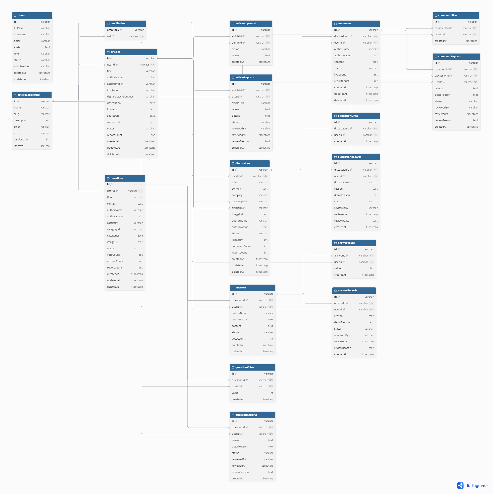

# 🔬 SciShare

<p align="center">
  
</p>

<h3 align="center">A Science-Sharing Android Application</h3>

<p align="center">
  Discover scientific knowledge, share ideas, and connect with curious minds.
</p>

<p align="center">
  
  
  
  
  
</p>

---

## 📖 About The Project

**SciShare** is an Android application designed for people who are passionate about science and knowledge sharing.

The platform provides a community-driven environment where users can explore scientific articles, publish discussions, ask questions, and exchange knowledge with other members.

SciShare also includes an administrative system for managing content, reviewing submitted articles, handling user reports, and maintaining a healthy learning community.

The application combines Firebase services with local SQLite storage to support data management and offline access.

## ✨ Features

### 👤 Authentication & Account Management
- User registration and login.
- Password recovery.
- Google Sign-In integration.
- Profile editing and password management.
- User session management.

### 📚 Scientific Articles
- Browse and read scientific articles.
- Search for articles.
- Explore articles by category.
- Submit new articles for administrative approval.
- View article details and PDF documents.
- Manage personal article submissions.
- Report inappropriate or misleading content.

### 💬 Discussion Community
- Create and share discussion posts.
- Browse community discussions.
- Comment on discussions.
- Manage personal discussions.
- Report inappropriate discussions and comments.

### ❓ Question & Answer (Q&A)
- Create scientific questions.
- Browse questions from the community.
- View question details.
- Submit answers and participate in discussions.
- Manage personal questions.
- Report inappropriate questions and answers.

### 🛡️ Administration
- Manage users.
- Review and moderate scientific articles.
- Manage discussions and Q&A content.
- Review user reports.
- Handle reported content and moderation actions.

### 📱 Offline Support
- Local SQLite database for cached application data.
- Offline data access through local data sources.
- Local PDF management for supported downloaded documents.
- Firebase Firestore integration for cloud data synchronization.

## 🛠️ Tech Stack

| Technology | Purpose |
|---|---|
| Java | Primary programming language |
| Android SDK | Android application development |
| XML | UI layouts and resources |
| Firebase Authentication | User authentication |
| Cloud Firestore | Cloud database |
| SQLite | Local data storage |
| AndroidX | Android support libraries |
| Material Components | UI components |
| RecyclerView | Displaying lists of content |
| Glide | Image loading |
| Picasso | Image loading |
| AndroidPdfViewer | PDF document viewing |
| Gradle Kotlin DSL | Project build configuration |

## 🏗️ Project Structure

```text
Group-11-Android-Wind/
│
├── app/
│   ├── src/
│   │   ├── main/
│   │   │   ├── java/com/example/myapplication/
│   │   │   │   ├── account/
│   │   │   │   ├── admin/
│   │   │   │   ├── articles/
│   │   │   │   ├── authentication/
│   │   │   │   ├── data/
│   │   │   │   │   └── local/
│   │   │   │   ├── discussions/
│   │   │   │   ├── qna/
│   │   │   │   ├── HomeFragment.java
│   │   │   │   ├── DiscussionFragment.java
│   │   │   │   ├── QnaFragment.java
│   │   │   │   └── MainActivity.java
│   │   │   │
│   │   │   ├── res/
│   │   │   │   ├── drawable/
│   │   │   │   ├── layout/
│   │   │   │   ├── layout-land/
│   │   │   │   ├── mipmap/
│   │   │   │   └── values/
│   │   │   │
│   │   │   └── AndroidManifest.xml
│   │   │
│   │   └── androidTest/
│   │
│   ├── build.gradle.kts
│   └── proguard-rules.pro
│
├── gradle/
│   └── wrapper/
│
├── img/
│
├── build.gradle.kts
├── gradle.properties
├── settings.gradle.kts
├── gradlew
├── gradlew.bat
└── README.md
```

## 🚀 Getting Started

Follow these instructions to set up and run SciShare locally.

### Prerequisites

Make sure you have installed:

- [Android Studio](https://developer.android.com/studio)
- Android SDK 36
- JDK 11 or a compatible JDK
- An Android device or emulator running Android 10 (API 29) or higher.

### Installation

**1. Clone the repository**

```bash
git clone https://github.com/Jimmy-02/Group-11-Android-Wind.git
```

**2. Open the project**

Open the cloned project directory in Android Studio.

**3. Configure Firebase**

- Create a project in the [Firebase Console](https://console.firebase.google.com/).
- Register an Android application using the package name:

```text
com.example.myapplication
```

- Download the `google-services.json` configuration file.
- Place it inside the `app/` directory.

**4. Enable Firebase Services**

Configure the following Firebase services:

- Firebase Authentication.
- Cloud Firestore.
- Google Sign-In, if using Google authentication.

Make sure the required authentication providers and Firestore security rules are configured.

**5. Build and Run**

Allow Android Studio to synchronize Gradle dependencies.

Then select an emulator or connected Android device and click **Run**.

Alternatively, build the application using Gradle:

```bash
# Windows
gradlew.bat assembleDebug

# macOS / Linux
./gradlew assembleDebug
```

## ⚙️ Technical Specifications

| Configuration | Value |
|---|---|
| Application ID | `com.example.myapplication` |
| Minimum SDK | API 29 (Android 10) |
| Target SDK | API 36 |
| Compile SDK | API 36 |
| Java Compatibility | Java 11 |
| Android Gradle Plugin | 8.13.2 |
| Firebase BOM | 33.16.0 |

## 🖼️ Project Resources

The `img/` directory contains project documentation resources, including:

- Functional diagrams.
- Class diagrams.
- Supporting project illustrations.

## 🎯 Project Objectives

Through SciShare, our team aims to:

- Encourage scientific knowledge sharing.
- Create an interactive learning community.
- Make scientific information more accessible.
- Promote meaningful discussions and knowledge exchange.
- Provide a structured environment for content moderation.

## 🗄️ Database Design

SciShare uses Firebase Cloud Firestore as its primary database
and SQLite for local data caching.

The following diagram illustrates the logical data relationships
between the application's main entities.

<p align="center">
  
</p>

## 📄 License

This project was developed for educational purposes as part of an academic Android application development project.

---
